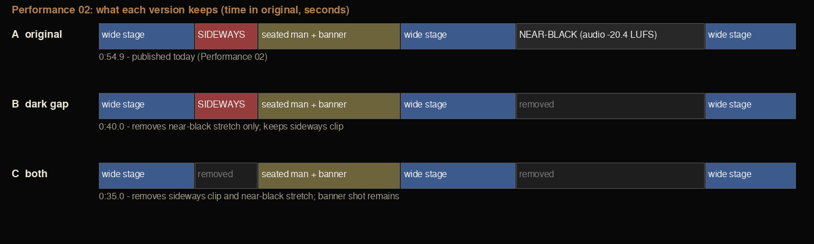

# Performance 02: comparison and recommendation (Stage 3.1)

Nothing here is published automatically. The site serves **A** today. The originals are untouched.

| | A. Original (published now) | B. Dark gap removed | C. Sideways clip and dark gap removed |
|---|---|---|---|
| File | `public/media/video/bishal-video-2.mp4` (= `media-src/originals/bishal video 2 - resubmitted upload.mp4`) | `media-derived/proposed/proposed-performance-02-dark-gap-removed.mp4` | `media-derived/proposed/proposed-performance-02-sideways-and-dark-removed.mp4` |
| Length | 0:54.9 | 0:40.0 | 0:35.0 |
| Size | 6.5 MB | 7.5 MB | 6.5 MB |
| Sideways clip (0:07.57-0:12.57) | kept | kept | **removed** |
| Near-black stretch (0:32.83-0:47.70) | kept | **removed** | **removed** |
| Seated man in front of a third-party concert banner (0:12.57-0:23.77) | kept | kept | kept |
| Re-encoded | no (byte copy) | yes | yes (H.264 CRF 18, AAC 96 kb/s, 40 ms audio fades at joins) |
| Integrated loudness | -20.4 LUFS | -20.6 LUFS | -26.4 LUFS |

SHA-256 values are in `MEDIA-CHECKSUMS.txt`. Contact sheets: `video-comparison/A-original-contact-sheet-1s.jpg` and `video-comparison/C-sideways-and-dark-removed-contact-sheet-2s.jpg`.

## Why the sideways clip is removed rather than corrected

The sideways clip is a landscape shot stored rotated inside the portrait frame. Rotating it upright gives a 16:9 picture that would have to be shrunk to about 576x324 pixels, a small letterboxed strip inside a 576x1024 frame, in the middle of full-height footage. That looks worse than the problem it fixes, so correction is not offered as a version. Removal is the practical fix.

## Findings that affect the decision

1. **The near-black stretch is not silent.** Its audio measures -20.4 LUFS, louder than the surrounding stage shots (about -25 to -27 LUFS). It may be live performance audio with the picture lost (for example a covered lens). That has not been listened to. Cutting it (B and C) would remove that audio too.
2. **The sideways clip is much louder** (-14.1 LUFS) than everything around it, which suggests a different recording situation. Removing it (C) also evens out the volume.
3. **C is quiet** (-26.4 LUFS). It would need a gain increase to match Performance 01 on a phone, which was not applied because it is a further irreversible-looking edit.
4. **A third-party concert banner** is visible for about 11 seconds in all three versions. Using footage that shows another organisation's banner is the owner's call. Cutting that shot as well would leave about 24 seconds of stage footage. That version was not made.
5. Faces are small throughout; nobody in the footage can be identified from the footage alone.

## Recommendation

1. **Keep A published for now.** It is the only version that loses nothing, and the public page no longer points out its flaws.
2. **Listen to 0:33-0:47 of the original.** If it is only room noise, publish **C**. It is the cleanest, shortest and most professional presentation, and it removes the two visible defects. If it contains the performance audio, do not cut it: keep A, or ask for a better recording.
3. Decide separately about the banner shot.
4. To publish a version: copy it into `public/media/video/`, update `src`, `durationSeconds` (35) and `startVolume` in `src/content/performances.ts`, re-run the poster step if the poster frame changes, and record the checksum. The originals stay where they are.

## Poster

Published poster: frame at 28.0 s (wide, two performers, blue curtain), alt text neutral.

Candidates in `media-derived/proposed/poster-candidates/`:
- `performance-02-at-25.0s.jpg`: the performer in the dark shirt is upright and kneeling with both hands out, the clearest pose and a slightly more readable face than 28.0 s. **Proposed.**
- `performance-02-at-6.5s.jpg`: a similar pose, earlier in the clip, with the performer smaller in frame.

I cannot tell from the footage which performer is Bishal, so I cannot claim "a frame where Bishal is clearly visible". The owner must say which performer he is (and at what time he is most visible). Until then the poster alt text names no one: it only describes the frame. If the owner identifies him, a poster can be chosen for that person and the alt text updated.

## Owner questions
- Which performer is Bishal in Performance 02?
- Is the audio in 0:33-0:47 needed?
- Is the third-party banner acceptable to show?
- Publish A, B or C?
